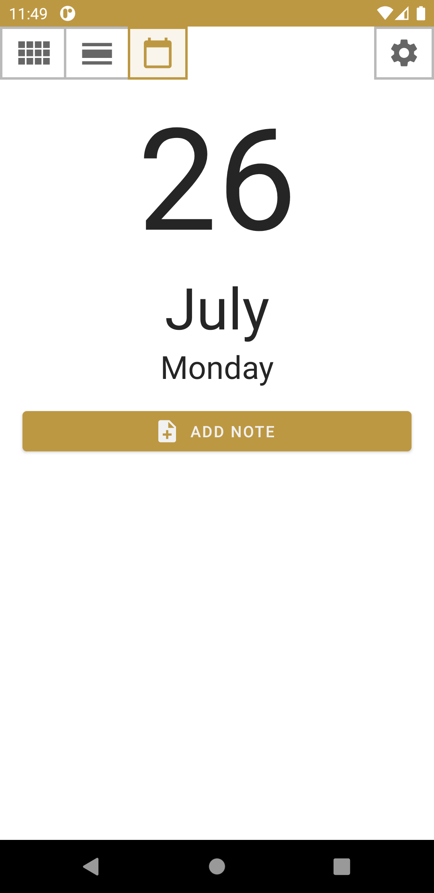
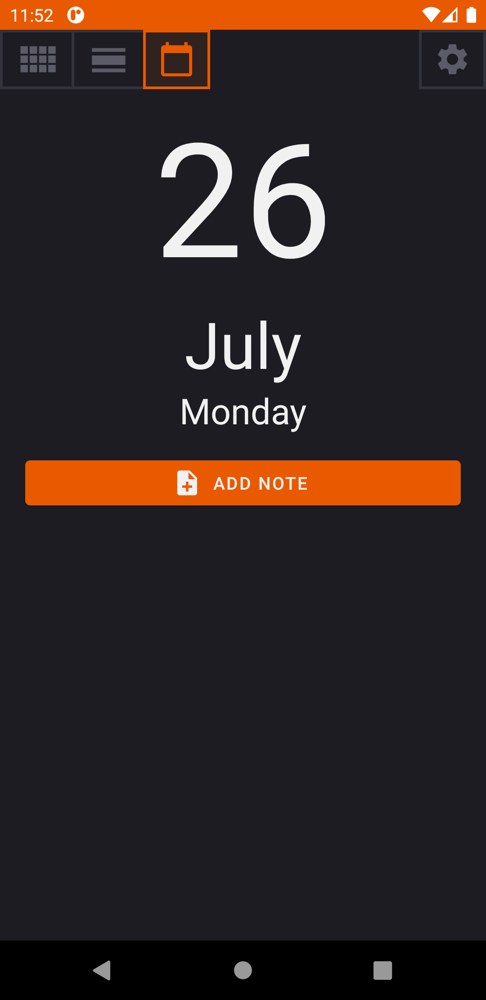
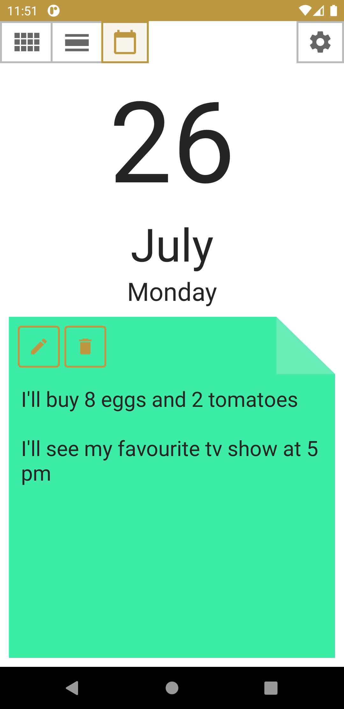
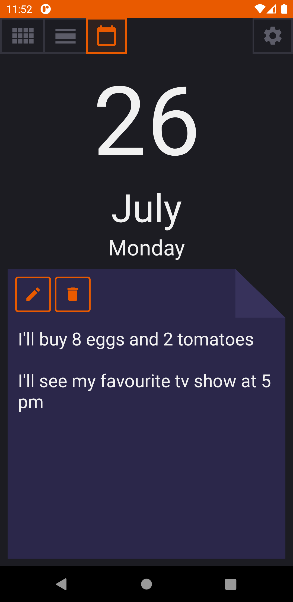
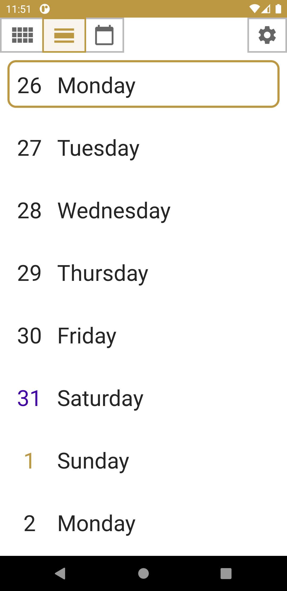
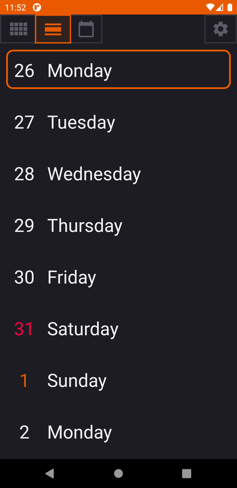

  

<h1 align="center">NoteCalendar</h1>

*Note Calendar* is a simple offline app which allows to manage notes for different days and offers a
quick way to reach each of them.

Minimum Android version: 5.0 (Lollipop, API level 21)

## Screenshots

  

  

## Features

* Day screen - used to add, edit or delete note and set a reminder for it.
* Month screen and week screen
  * Days that constain a note are marked with a ring.
  * The currently selected day is marked with a solid circle.
  * Today's date is marked with a different text color.
  * Long-press on a day's number to quickly add or edit a note for that day.
  * A find button that allows to search notes by text, with optional case-sensitive and date-range filters.
* Settings screen
  * Notes - notes-specific settings, including options to import and export notes.
  * Calendar - calendar-specific settings, such as first day of the week.
  * Theme - choose a light or dark theme, create your own theme, and export it.
  * About - information about the application.

## Translations

You can help with translations on https://hosted.weblate.org/projects/note-calendar/.

### Specific translation strings

`?` - means the translation is optional and is already translated by the Android. You can however
translate it if the automatic translation is not the best fit for your language.

`%s` - is an argument inside string, provided by the application. It can be a thing like number 
or date. You need to keep this argument in your translation.

## License

*NoteCalendar* is licensed under the MIT license.

[More about license](LICENSE)

[Privacy Policy](PRIVACY-POLICY.md)